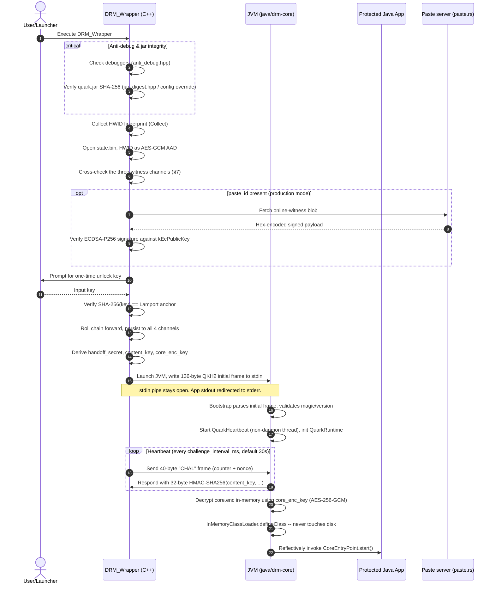

# Quark: A Cross-Platform, Cryptographically-Interlocked DRM & Licensing Engine

**Document type:** internal engineering specification (RFC-style), not an IETF submission.
**Status:** active development. Build authority is currently **compile-only** — see §14.
**Scope:** describes the system as implemented in this repository as of the commit this file
ships with. Where a claim is platform- or verification-specific, that scope is stated explicitly
rather than implied.

---

## Table of contents

1. [Abstract](#1-abstract)
2. [Conventions and terminology](#2-conventions-and-terminology)
3. [Core principle: cryptographic interlocking](#3-core-principle-cryptographic-interlocking)
4. [Architecture overview](#4-architecture-overview)
5. [Hardware fingerprinting (HWID)](#5-hardware-fingerprinting-hwid)
6. [The Lamport one-time-key chain](#6-the-lamport-one-time-key-chain)
7. [The four-channel witness system](#7-the-four-channel-witness-system)
8. [The QKH2 handoff protocol and JVM pipeline](#8-the-qkh2-handoff-protocol-and-jvm-pipeline)
9. [Reversible instruction scrambling, no new ISA (`quark_codecipher`)](#9-reversible-instruction-scrambling-no-new-isa-quark_codecipher)
10. [The C ABI (`quark_c_api`) — the language-agnostic surface](#10-the-c-abi-quark_c_api--the-language-agnostic-surface)
11. [Repository layout and module index](#11-repository-layout-and-module-index)
12. [Build instructions](#12-build-instructions)
13. [Testing and verification methodology](#13-testing-and-verification-methodology)
14. [Scope, build authority, and the developer security checklist](#14-scope-build-authority-and-the-developer-security-checklist)
15. [Security considerations](#15-security-considerations)
16. [References](#16-references)

---

## 1. Abstract

Quark is a native C++ DRM/licensing engine built on three primitives — hardware-fingerprint
binding, a Lamport one-time-key hash chain, and AES-256-GCM cryptographic interlocking — exposed
through a plain `extern "C"` surface (`cpp/quark_c_api`) so it is callable **in-process** from any
language with an FFI: Go (cgo), Python (ctypes/cffi), Java (JNI/Panama), Rust (bindgen), or C/C++
directly. There is no server component; every check is offline and hardware-bound. The system
ships two protection mechanisms for the two shapes a protected asset can take:

- **`quark_codecipher`** (§9) — reversibly scrambles a program's own real machine code (AES-256-CTR)
  and reconstructs it byte-for-byte at runtime, for native and cross-language consumers of
  `quark_c_api`. macOS only so far.
- **The JVM pipeline** (§8) — `DRM_Wrapper` + `quark.jar`, talking over the QKH2 pipe protocol,
  which decrypts and loads real JVM class bytes (`core.enc`) directly into memory via a custom
  `ClassLoader`, never touching disk.

Both mechanisms are built on the same underlying guarantee: a protected asset cannot execute
without a decryption key that only this engine can produce, and the engine cannot produce that key
without a valid hardware fingerprint **and** a valid Lamport chain step. What a caller does with
that key is the caller's choice, not something the engine assumes.

`quark_core` (`cpp/common`) — the crypto, KDF, Lamport chain, `state.bin` codec, and orchestration
logic — has zero OS-specific API calls and builds and is genuinely tested (no mocks, ever — see
§13) on any OS with a C++17 compiler and mbedTLS. Three OS-specific platform layers
(`quark_platform_win`, `quark_platform_macos`, `quark_platform_linux`) implement the same
`IHwidBackend`/`IWitnessStore` contracts so neither `quark_core` nor a consumer needs to know which
OS it is running on. As of this document, **all six originally Windows-only executables**
(`HWID_Extractor`, `Dev_Keygen`, `DRM_Wrapper`, `Paste_Test`, `handoff_spy`, and the
`quark-runtime-c` library) **build and run on every OS**; see §12 and §13 for exactly what has and
has not been independently re-verified per platform.

---

## 2. Conventions and terminology

This document uses RFC-2119-style emphasis (**MUST**, **MUST NOT**, **SHOULD**) informally, to
flag load-bearing invariants rather than as a formal conformance language, since this is a single
implementation, not a multi-implementor protocol.

| Term | Definition |
|---|---|
| **HWID** | A machine's hardware fingerprint: 16 independently-sourced fields on Windows (`quark::hwid::Components`), 11 on macOS/Linux (`IHwidBackend`). See §5. |
| **`hwid_canonical`** | The deterministic, `\x1F`-joined serialization of every HWID field in a fixed order (`CanonicalBytes`). This exact byte string is what enters AES-GCM as AAD and SHA-256 as KDF input. |
| **Lamport chain** | A hash chain `H^0(x) … H^n(x)` (H = SHA-256) built from a random seed `x`; `n` = the number of licensed uses. See §6. |
| **Anchor** | The chain position currently stored as "the value the next redeemed key must hash to" — `H^k(x)` for the current remaining depth `k`. |
| **`state.bin`** | The primary, AES-256-GCM-sealed file holding the anchor, remaining-uses counter, and `original_chain_length`, with `hwid_canonical` as AAD. |
| **Witness channel** | One of three secondary, independently-sealed copies of the chain position (registry / ADS / exe-ADS on Windows; two xattr-backed + one portable file store on macOS/Linux). See §7. |
| **`content_key`** | Session-specific key (`SHA256("QUARK-CORE-CONTENT-KEY" \|\| handoff_secret)`) used for the QKH2 challenge-response HMAC and `@QuarkCheckpoint` tokens. Changes every unlock. |
| **`core_enc_key`** | Stable, per-license key (`SHA256("QUARK-CORE-ENC-KEY" \|\| state_key \|\| SHA256(online_secret) \|\| hwid_canonical)`) used to decrypt `core.enc`. Does not change between sessions — it has no anchor dependency, only HWID + build secret + online secret. |
| **`code_key`** | `HMAC-SHA256(content_key, "QUARK-CODE-STREAM-KEY")` — the domain-separated key `quark_codecipher`'s AES-256-CTR scramble uses. Carries no independent authentication; see §9. |
| **Checkpoint** | A `QuarkRuntime.checkpoint(id)` call injected by `quark-protect` at a developer-annotated `@QuarkCheckpoint` method; its HMAC-derived return value is meant to feed real computation, not be branched on. |
| **Fail-deadly** | This system's failure discipline: any anomaly collapses to an immediate, unrecoverable exit — never a silent fallback, retry, or degraded mode. See §15. |
| **Boolean trap** | The anti-pattern this system is explicitly designed to avoid: an `if (licensed)` branch that an attacker can patch to `true`. Every check here instead makes *wrong data* (a key, a decrypted class, a computed value) rather than a patchable verdict. |

---

## 3. Core principle: cryptographic interlocking

> A protected application **MUST NOT** be able to run without a decryption key that only this
> engine can produce, and the engine **MUST NOT** be able to produce that key without (a) a valid
> hardware fingerprint and (b) a valid Lamport chain step.

This single sentence is the entire security model. Every mechanism in this document exists to
enforce one half of it:

- **§5–§7** enforce "a valid hardware fingerprint and a valid Lamport chain step" — HWID as AAD
  and KDF input (not a boolean check), one-way chain redemption, and tamper/rollback detection
  across four independently-sealed copies of the license state.
- **§8–§9** enforce "cannot run without a decryption key only this engine can produce" — for JVM
  targets via in-memory class decryption (`core.enc`), for native/cross-language targets via
  real-machine-code scramble/reconstruct (`quark_codecipher`).

Zero external dependencies is a corollary, not a separate goal: every trust anchor above is a
cryptographic derivation from local material (HWID + build secret + Lamport state), never a
network call or a stored boolean. See §15 for the honest limits of this model.

---

## 4. Architecture overview

```
                     ┌──────────────────────────────────────────┐
                     │              cpp/quark_c_api               │
                     │   extern "C" surface: quark_hwid_collect,   │
                     │   quark_lamport_mint_chain, quark_state_    │
                     │   mint, quark_seal_payload,                 │
                     │   quark_unlock_and_decrypt                  │
                     └───────────────┬────────────────────────────┘
                                     │ links
                     ┌───────────────▼────────────────────────────┐
                     │                quark_core                   │
                     │  (cpp/common) crypto · token (KDF) ·        │
                     │  lamport · state.bin codec · payload codec  │
                     │  · orchestrator (RunUnlockFlow) · error     │
                     │  registry · portable FileWitnessStore ·     │
                     │  quark::config (key=value reader).          │
                     │  Zero OS API calls -- builds and is         │
                     │  genuinely tested on any OS (CLAUDE.md #1). │
                     └───────┬────────────────────┬─────────────────┘
                             │                     │
              ┌──────────────▼─────┐   ┌───────────▼───────────────┐   ┌────────────────────┐
              │ quark_platform_win  │   │ quark_platform_macos       │   │ quark_platform_linux│
              │ SMBIOS/CPUID/       │   │ sysctlbyname/IOKit/        │   │ /proc, /etc/machine- │
              │ registry/ADS/       │   │ DiskArbitration, xattrs    │   │ id, world-readable   │
              │ WinHTTP             │   │ (2 of 3 secondary          │   │ /sys/class/dmi/id,   │
              │                     │   │ witnesses)                 │   │ xattrs               │
              └─────────────────────┘   └────────────────────────────┘   └────────────────────┘

  Consumers of quark_c_api / quark_core (all cross-platform: build & run on Win/macOS/Linux):
  ┌───────────────────────────────┐   ┌───────────────────────────────────┐
  │ DRM_Wrapper + quark.jar        │   │ cpp/quark_codecipher (macOS only)  │
  │ (JVM pipeline, QKH2 protocol   │   │ (reversible real-machine-code      │
  │ over anonymous pipes)          │   │  scramble/reconstruct for native/  │
  │                                │   │  cross-language logic -- see §9)   │
  └───────────────────────────────┘   └───────────────────────────────────┘
```

`quark_core` is the only piece every platform builds and tests for real (no mocks, ever —
CLAUDE.md rule 1). Each `quark_platform_<os>` target implements the same
[`IHwidBackend`/`IWitnessStore`](cpp/common/include/quark/platform/hwid_backend.hpp) contracts so
neither `quark_core` nor a consumer needs to know which OS it is running on. `DRM_Wrapper`'s
`main.cpp` selects between them with four small, explicitly-marked `#ifdef` seams — anti-debug, the
HWID backend, the witness stores, and the process-launch/challenge-loop pair — everything else is
one shared, portable flow (`quark::orchestrator::RunUnlockFlow`).

---

## 5. Hardware fingerprinting (HWID)

`quark::hwid::CanonicalBytes` deterministically serializes every fingerprint field, in a fixed
order, joined by `\x1F` separators, into one byte string. This string is then used **twice**: as
AES-GCM Associated Authenticated Data (AAD) on every `state.bin`/witness read-write, and as direct
input to the SHA-256 KDF that derives `state_key` and `handoff_secret` (`quark::token`). Because
the string is SHA-256'd, changing even one character anywhere avalanches into a completely
different key/tag — there is **no** partial-match, fuzzy-match, or "close enough" tolerance, by
construction. `Collect()` requires **every** field to read successfully; a partial fingerprint is
rejected outright rather than silently treated as a fresh install.

### 5.1 Windows — 16 fields (reference implementation)

All raw-API, never WMI (WMI normalizes/caches/virtualizes far more readily than raw SMBIOS/CPUID
tables):

| # | Field | Source |
|---|---|---|
| 1 | `cpu_vendor_signature` | `__cpuid` leaves 0/1 |
| 2 | `cpu_brand` | `__cpuid` leaves 0x80000002–4 |
| 3 | `cpu_logical_cores` | `__cpuid` leaf 1 (HTT-aware) |
| 4 | `board_uuid` | SMBIOS Type 1 |
| 5 | `board_manufacturer` | SMBIOS Type 2 |
| 6 | `bios_identity` | SMBIOS Type 0 |
| 7 | `chassis_identity` | SMBIOS Type 3 |
| 8 | `processor_identity` | SMBIOS Type 4 |
| 9 | `ram_fingerprint` | SMBIOS Type 17, every populated slot |
| 10 | `system_disk_serial` | `IOCTL_STORAGE_QUERY_PROPERTY` on the boot drive |
| 11 | `system_volume_serial` | `GetVolumeInformation` |
| 12 | `all_disk_serials` | `IOCTL_STORAGE_QUERY_PROPERTY` on every attached drive |
| 13 | `gpu_fingerprint` | DXGI `IDXGIAdapter1::GetDesc1`, every non-software adapter |
| 14 | `mac_address` | `GetAdaptersAddresses`, first non-virtual NIC |
| 15 | `machine_guid` | `HKLM\...\Cryptography\MachineGuid` |
| 16 | `windows_product_id` | `HKLM\...\Windows NT\CurrentVersion\ProductId` |

### 5.2 macOS and Linux — 11 fields each

Same philosophy (independent, low-level, all-or-nothing), different sources —
`IHwidBackend` only requires "every field independently verified real". Honest deltas from
Windows: neither OS has per-DIMM RAM identity; macOS's Hardware UUID **survives** an OS reinstall
(Windows' `MachineGuid` does not); Linux deliberately excludes root-only DMI fields
(`product_uuid`, `board_serial`) to stay unprivileged, scoped to x86_64/UEFI (DMI is an
x86-firmware convention). Full field-by-field rationale:
[`hwid_backend_macos.hpp`](cpp/common/include/quark/platform/macos/hwid_backend_macos.hpp),
[`hwid_backend_linux.hpp`](cpp/common/include/quark/platform/linux/hwid_backend_linux.hpp).

---

## 6. The Lamport one-time-key chain

Licensing "expiry" in Quark is **not** a clock check (see §15). It is chain depth, full stop:

1. At issuance (`Dev_Keygen`), pick a random seed `x` and a chain length `n` (= number of licensed
   uses). Compute `H^0(x), H^1(x), …, H^n(x)` where `H = SHA-256`.
2. Distribute `H^n(x)` (the anchor) to the customer inside `state.bin`, HWID-bound via AAD.
3. Each unlock, the caller supplies the *previous* preimage `H^{k-1}(x)`. The engine checks
   `SHA256(supplied) == stored_anchor`, then rolls `stored_anchor = supplied` and decrements the
   counter — one-way (SHA-256 cannot be inverted to recover an earlier preimage), replay-proof, and
   self-exhausting.
4. The roll is persisted to `state.bin` **and** all three witness channels (§7) **before** the
   protected asset is ever unlocked/launched — so a crash between "spend" and "reward" cannot be
   used to replay a free use (see [PROGRAM_FLOW.md](docs/PROGRAM_FLOW.md) step 6 for the exact
   ordering argument).

---

## 7. The four-channel witness system

A single AEAD-sealed file proves a file was not *edited* — it cannot prove the file was not
wholesale *replaced* with an earlier, validly-sealed copy of itself (a backup-restore "rewind"
attack). Quark closes most of that gap with three independent, domain-separated secondary copies
of the chain position, in addition to `state.bin`:

| Channel | Windows location | macOS/Linux location | Key domain label |
|---|---|---|---|
| Primary | `state.bin` (disk) | `state.bin` (disk) | `"QUARK-STATE-KEY"` |
| Secondary 1 | `HKCU\Software\Quark\License` (registry) | xattr on witness host file | `"QUARK-REGISTRY-KEY"` |
| Secondary 2 | `%APPDATA%\...\ThemeCache:q` (NTFS ADS) | xattr on witness host file | `"QUARK-ADS-KEY"` |
| Secondary 3 | `DRM_Wrapper.exe:quark` (NTFS ADS on the exe) | portable `FileWitnessStore` | `"QUARK-OVERLAY-KEY"` |

All four must agree, byte-for-byte, on the chain position on every launch. `state.bin` (format v2)
carries an immutable `original_chain_length`, set once at mint time. The count of **absent**
secondary witnesses (`absent_count`, 0–3) drives a four-way branch:

- `absent_count == 3` **and** `remaining_links == original_chain_length` → genuine first run; mint
  all three.
- `absent_count == 3` **and** `remaining_links < original_chain_length` →
  `kWrapperWitnessMissingAfterUse` (a used, then witness-stripped `state.bin` restored from
  backup — no longer passes as day one).
- `absent_count` 1 or 2 → `kWrapperWitnessMismatch` (selective absence = selective tamper).
- `absent_count == 0` → all three must independently authenticate **and** byte-match `state.bin`;
  any disagreement → `kWrapperWitnessMismatch`.

Each secondary witness also carries a `high_water_unix_time`, taken as `max()` across all three on
every launch — a one-way ratchet, **not** a clock-trust expiry check (§15). It only fires
`kWrapperClockRollbackDetected` when "now" is observed *earlier* than that maximum; a forward or
normal clock grants nothing.

**Concurrent-launch exclusion.** The witness system above defends against an attacker rewinding
state *between* launches. It does not, by itself, defend against two launches racing on the *same*
license at the *same* time — real concurrent-launch testing found exactly this gap (7 of 10
simultaneous `DRM_Wrapper` launches with one key all succeeding before the fix). `RunUnlockFlow`
now takes an `quark::platform::IProcessLock*` (`FlockProcessLock` on POSIX via `flock(2)`,
`LockFileProcessLock` on Windows via `LockFileEx`) that it acquires before touching `state.bin` and
releases on every return path; both `DRM_Wrapper` and `quark_c_api`'s `quark_unlock_and_decrypt`
always supply one. Verified for real: with the lock, 10-way concurrent launches through
`DRM_Wrapper` and 8-way concurrent calls through the C ABI both yield exactly one success.

**Honest limit:** snapshotting and restoring *all four* channels simultaneously (including
`state.bin`) cannot be distinguished from a legitimate state, since nothing anywhere disagrees with
the restored copy at that point. No purely offline design can close this — it is an inherent
ceiling of "no server component," not an oversight.

---

## 8. The QKH2 handoff protocol and JVM pipeline

`DRM_Wrapper` is the historical, and still fully-supported, consumer of this engine. Its full
launch sequence (identical on every OS at the `quark::orchestrator` level; only anti-debug, HWID
backend, witness stores, and process-launch differ per `#ifdef`):



The 136-byte QKH2 initial frame layout, the two-key separation (`content_key` for
challenge-response vs. `core_enc_key` for `core.enc`), and the full challenge/response byte layout
are specified in [`docs/HANDOFF_PROTOCOL.md`](docs/HANDOFF_PROTOCOL.md); the sentence-by-sentence
walk of every step above (in Turkish) is in
[`docs/PROGRAM_FLOW.md`](docs/PROGRAM_FLOW.md). Neither the handoff secret nor `core_enc_key` ever
touch `argv` — they cross exclusively inside the QKH2 frame over an anonymous pipe. Killing either
process — parent or child — kills the other within one heartbeat interval (mutual assured
destruction by pipe coupling, not by convention): the child detects a broken stdin pipe and calls
`Runtime.getRuntime().halt(-1)`; the parent calls `TerminateProcess`/`kill` on a missed or wrong
challenge response.

For a language-agnostic consumer talking to `quark_c_api` directly, the equivalent sequence is much
shorter: `quark_hwid_collect` → `quark_unlock_and_decrypt` (runs the whole HWID/`state.bin`/witness/
chain flow internally and returns decrypted plaintext, or nothing) → feed that plaintext to
`quark_codecipher::Materialize` if it is a scrambled `CodeRegion`, or use it directly if it is
already the protected asset.

---

## 9. Reversible instruction scrambling, no new ISA (`quark_codecipher`)

For native and cross-language consumers of `quark_c_api` there is no JVM to hand encrypted class
bytes to. `quark_codecipher` (macOS only so far) is the equivalent mechanism — but unlike an
earlier, now-removed approach (`quark_vm`, a bytecode interpreter with its own instruction set),
it never translates a program's logic into anything else. It scrambles a program's own real,
compiled machine code and reconstructs it byte-for-byte at runtime; what runs is the exact
instructions the compiler emitted, executed directly by the CPU, not interpreted.

```mermaid
stateDiagram-v2
    [*] --> RealMachineCode
    RealMachineCode --> Scrambled: Capture() -- Aes256CtrXor(code_key)
    Scrambled --> SealedInCoreEnc: SerializeCodeRegion + quark::payload::Seal(content_key)
    SealedInCoreEnc --> Scrambled: Unseal(content_key) at runtime
    Scrambled --> Reconstructed: Materialize() -- same Aes256CtrXor call, self-inverting
    Reconstructed --> Executing: relocations patched, MAP_JIT flipped executable

    RealMachineCode: Real compiled machine code (Capture's input)
    Scrambled: Unrecognizable bytes (X) -- no longer resembles real instructions
    SealedInCoreEnc: Inside core.enc (the ONLY AES-256-GCM layer)
    Reconstructed: Byte-for-byte identical to the original (A)
    Executing: Executing (real CPU, real instructions, no interpreter)
```

The defining property carries over from the JVM side unchanged in spirit but different in
mechanism: **a wrong `content_key` never reaches `quark_codecipher` at all.** `Capture`'s scramble
uses AES-256 in CTR mode (`quark::crypto::Aes256CtrXor`) — a keyed keystream XOR with no
authentication tag of its own, because it never needs one: the scrambled bytes already live inside
`core.enc`'s single AES-256-GCM seal, and a wrong `content_key` fails structurally at
`quark::payload::Unseal` — before `Materialize` ever sees a byte. There is no second key to get
wrong, and therefore no "wrong key produces wrong data" story to build at this layer at all; that
guarantee belongs entirely to the outer seal, exactly as it does everywhere else in this codebase
(`state.bin`, the four witness channels, `core.enc`'s Java payload).

Function-level granularity with automatic internal/external reference classification is the
load-bearing design choice: `Capture` scans for ARM64's PC-relative instructions (`ADRP`/`B`/`BL`/
`B.cond`) and only records a relocation for targets **outside** the captured byte range — an
internal branch (e.g. an `if`/`else` jumping between a function's own basic blocks) needs no fixup
at all, because relative offsets stay correct automatically when the whole function moves as one
contiguous block. This was proven both algebraically and against real, compiler-generated,
externally-dependent code (a mutated global variable, a real `printf` call through a relocated
`BL`). See [`cpp/quark_codecipher/README.md`](cpp/quark_codecipher/README.md) for the full
mechanism and its honest scope limits, and `docs/PLAN.md`'s Phase XVI for why the earlier
bytecode-VM approach was replaced rather than merely re-layered.

**Not yet done:** Linux/Windows equivalents of `Materialize`'s executable-memory handling (macOS's
`MAP_JIT` only); relocation detection is a bit-pattern scan over raw bytes, not a real disassembler
or linker relocation records; `CBZ`/`CBNZ`/`TBZ`/`TBNZ` and PC-relative literal loads are not
handled; and `Capture` reads already-loaded, same-process function bytes rather than a real
dev-time toolchain step reading a linker's relocation records. Not yet wired into `quark_c_api.h`'s
public surface.

---

## 10. The C ABI (`quark_c_api`) — the language-agnostic surface

`cpp/quark_c_api` is the plain `extern "C"` entry point over `quark_core`:

| Function | Purpose |
|---|---|
| `quark_hwid_collect` | Collects this machine's fingerprint into a caller-supplied buffer. |
| `quark_lamport_mint_chain` | Builds a Lamport chain of a given length; returns the anchor and first redeemable key. |
| `quark_state_mint` | Writes a fresh, HWID-bound `state.bin`. |
| `quark_seal_payload` | AES-256-GCM-seals an arbitrary payload under a HWID-derived key. |
| `quark_unlock_and_decrypt` | The whole unlock flow in one call: HWID collect → `state.bin` open → witness cross-check → key verify → chain roll → payload decrypt. The **only** way to reach a sealed payload's plaintext — `core_enc_key`/`content_key` never cross this boundary directly, closing the boolean-trap gap a raw-key-returning API would leave open. |
| `quark_error_describe` | Maps a numeric error code to a human-readable string (mirrors `quark::error::Describe()`). |

Error codes are shared 1:1 with `quark::error::Code` via compile-time `static_assert`s. The
function never terminates its host process or prompts for input — every call returns a
`quark_error_t` and the caller decides what happens next. This is the property that makes it
callable from Go/Python/Java/Rust hosts without those languages needing to understand
`exit(1)`-style fail-deadly semantics themselves.

`quark_unlock_and_decrypt` internally constructs and holds an `IProcessLock` for the duration of the
call (§7), so concurrent calls — whether from multiple threads in one host process or multiple
separate host processes — correctly serialize on the same license, exactly like `DRM_Wrapper`
itself. See [`cpp/quark_c_api/README.md`](cpp/quark_c_api/README.md) for the full function
signatures and [`cpp/quark_c_api/tests/`](cpp/quark_c_api/tests/) for the real (non-mocked)
verification, including an 8-thread concurrent-redemption test against the actual C ABI.

---

## 11. Repository layout and module index

```
Quark/
├── cpp/
│   ├── common/            # quark_core (OS-agnostic) + quark_platform_win/macos/linux
│   ├── quark_c_api/       # The language-agnostic C ABI over quark_core
│   ├── quark_codecipher/  # Reversible instruction scramble/reconstruct (§9), macOS only
│   ├── drm_wrapper/       # The JVM-pipeline consumer (DRM_Wrapper); cross-platform
│   ├── dev_keygen/        # Developer license/keygen CLI (Dev_Keygen); cross-platform
│   ├── hwid_extractor/    # Standalone HWID export utility (HWID_Extractor); cross-platform
│   ├── handoff_spy/       # Mock JVM launcher for QKH2 pipe-protocol testing; cross-platform
│   ├── paste_test/        # Live paste.rs integration test (Paste_Test); cross-platform
│   └── quark-runtime-c/   # Native C/C++ runtime bindings (QKH2 pipe side); cross-platform
├── java/
│   ├── drm-core/          # JVM bootstrap loader (Bootstrap, InMemoryClassLoader, heartbeat)
│   ├── quark-sdk/         # Developer-facing annotations (@QuarkProtected, @QuarkCheckpoint)
│   ├── main-app/          # Reference protected application structure
│   └── test-app/          # Minimal end-to-end integration client
├── tools/
│   ├── quark-protect/     # Bytecode transformer injecting checkpoint calls (ASM 9)
│   ├── quark-build/       # Packs classes into the InMemoryClassLoader wire format
│   └── e2e-test/          # Automated end-to-end integration test runner
├── examples/              # Cross-language protection matrix (Go/C/C++/Java x
│                          # external-wrapper/source-embedded, 8 demos) -- see §13
└── docs/                  # Protocol/error/SDK specs, design specs, implementation plans
```

Every OS-specific claim below is scoped precisely: "cross-platform" means the CMake target has no
`if(WIN32)`/`if(APPLE)` build guard and links only `quark_common`, which itself resolves to the
right `quark_platform_<os>`; it does **not** by itself mean every OS has been independently
re-verified — see §13 for the exact verification matrix.

### 11.1 Module index

*   [cpp/common](cpp/common/README.md) — `quark_core`: OS-agnostic crypto/KDF/Lamport/state/
    payload/orchestrator logic, plus the `quark_platform_win`/`quark_platform_macos`/
    `quark_platform_linux` HWID and witness-storage backends.
*   [cpp/quark_c_api](cpp/quark_c_api/README.md) — §10.
*   [cpp/quark_codecipher](cpp/quark_codecipher/README.md) — §9's scramble/reconstruct modules.
*   [cpp/drm_wrapper](cpp/drm_wrapper/README.md) — §8's C++ side: anti-debug, witness
    verification, QKH2 handoff, challenge-response heartbeat loop. Config-driven
    (`drm_wrapper.conf`) per CLAUDE.md rule 2.
*   [cpp/dev_keygen](cpp/dev_keygen/README.md) — Mints `state.bin` licenses, exports activation
    keys, encrypts class bundles (`core.enc`); `--dev` mode for offline/no-paste.rs testing,
    `--setup`/`--burn`/`--revoke`/`--list` for the full license lifecycle.
*   [cpp/hwid_extractor](cpp/hwid_extractor/README.md) — Customer-facing console utility exporting
    a machine's HWID as JSON.
*   [cpp/handoff_spy](cpp/handoff_spy/README.md) — Diagnostic mock JVM launcher for exercising the
    QKH2 pipe protocol without a real JVM (hand-rolled SHA-256/HMAC, deliberately independent of
    `quark_common`/mbedTLS — see the module's own README for why).
*   [cpp/quark-runtime-c](cpp/quark-runtime-c/README.md) — Native C/C++ runtime bindings for the
    QKH2 pipe side (`quark_checkpoint(id)`, heartbeat thread) for non-JVM protected applications.
*   [cpp/paste_test](cpp/paste_test/README.md) — Live network integration test against the
    `paste.rs` online-witness backend (not part of the default `ctest` run — see §13).
*   [java/drm-core](java/drm-core/README.md) — The JVM loader:
    [Bootstrap.java](java/drm-core/src/main/java/quark/drmcore/Bootstrap.java),
    [InMemoryClassLoader.java](java/drm-core/src/main/java/quark/drmcore/InMemoryClassLoader.java),
    [QuarkHeartbeat.java](java/drm-core/src/main/java/quark/drmcore/QuarkHeartbeat.java).
*   [java/quark-sdk](java/quark-sdk/README.md) — Developer-facing annotations and compile-time
    stub `QuarkRuntime` (shadowed at runtime by the real implementation in `quark.jar`).
*   [java/main-app](java/main-app/README.md) — Reference protected application structure.
*   [java/test-app](java/test-app/README.md) — Minimal end-to-end integration test client
    (`CoreEntryPoint`, loaded by name from `core.enc`).
*   [tools](tools/README.md) — Bytecode instrumentation (`quark-protect`), bundle packaging
    (`quark-build`), and the end-to-end test runner ([`tools/e2e-test`](tools/e2e-test/README.md)).

---

## 12. Build instructions

### 12.1 Prerequisites

*   C++17 compiler (MSVC on Windows, Clang on macOS, GCC/Clang on Linux)
*   CMake 3.21+
*   JDK 17+ with Gradle (Java/tools side only; the shipped Java sources target bytecode level 8
    for the runtime-loaded modules, so any JDK 8+ toolchain compiles them)

### 12.2 C++ native components (CMake)

All build and test activity happens under `sandbox/` (CLAUDE.md rule 1) — **never** at the repo
root or any system-wide temp directory:

```bash
cmake -S . -B sandbox/build-host
cmake --build sandbox/build-host
ctest --test-dir sandbox/build-host --output-on-failure
```

*   `quark_core` and `quark_c_api` build and test on **any OS** — neither touches a Win32/
    POSIX-specific API. `quark_codecipher` builds only on macOS today (its `Materialize` step uses
    `MAP_JIT`).
*   `quark_platform_<os>` builds only for the OS it targets; `quark_common` (and therefore every
    consumer) links whichever one matches the host automatically.
*   `HWID_Extractor`, `Dev_Keygen`, `DRM_Wrapper`, `Paste_Test`, `handoff_spy`, and
    `quark-runtime-c` have **no** OS build guard and compile on Windows, macOS, and Linux alike.
    Cross-compilation is deliberately not used to prove this (a cross-compiled `.exe` still cannot
    be *executed* on the host doing the compiling — see the CI-matrix rationale in
    [CLAUDE.md](CLAUDE.md)); each OS's binaries are meant to be built and run on real,
    OS-native machines or CI runners (`windows-latest`/`macos-latest`/`ubuntu-latest` or
    equivalent).

### 12.3 Java components & tools (Gradle)

```bash
cd java
./gradlew :drm-core:jar :quark-sdk:jar :test-app:jar

cd ../tools
./gradlew :quark-protect:jar :quark-build:jar
```

### 12.4 Minting a real, working license end-to-end (`--dev` mode)

For local experimentation without a `paste.rs` deployment, `Dev_Keygen --dev` skips the online
witness entirely (fixed all-zero `online_secret`) and produces a fully-working, HWID-bound license
on the current machine:

```bash
HWID_Extractor hwid.json
Dev_Keygen hwid.json 3 . --dev --label "local-test" --input-bundle app.bundle   # optional core.enc
# writes state.bin, unlock_keys.txt, and (with --input-bundle) core.enc
```

`app.bundle` is produced from a `@QuarkProtected`/`@QuarkCheckpoint`-annotated jar via
`quark-protect` (bytecode instrumentation) then `quark-build` (packs classes into the
`InMemoryClassLoader` wire format) — see [`tools/README.md`](tools/README.md). **`--dev` mode is
explicitly marked "never for production"** in `Dev_Keygen`'s own usage text: `core_enc_key`
derivation with a fixed `online_secret` is deterministic across licenses in dev mode.

---

## 13. Testing and verification methodology

Per CLAUDE.md rule 1, **there are no mocks anywhere in this repository, including tests.** Every
test compiles and runs for real, directly against the real OS it targets: real mbedTLS, real
filesystem, real registry/xattr/SMBIOS calls, real pipes, real subprocesses, real threads.

| Layer | What is verified | Where |
|---|---|---|
| `quark_core` unit/round-trip tests | Crypto primitives, KDF derivations, Lamport chain math, `state.bin` codec, QKH2 frame codec, `quark::config` file round-trip | `cpp/common/tests/`, runs on every OS |
| Platform backend tests | Real HWID collection and real witness read/write, per OS | `cpp/common/tests/platform_*_test.cpp`, macOS + Linux verified for real; Windows implemented, not yet re-run in this pass |
| `quark_codecipher` tests | Capture/Materialize correctness against real dlopen'd functions (zero/internal-only/external relocations), plus the full single-encryption pipeline including the wrong-key negative case | `cpp/quark_codecipher/tests/`, macOS-verified |
| `quark_c_api` tests | Full C ABI round-trip (HWID → mint → seal → unlock+decrypt), plus an 8-thread concurrent-redemption test against the real `IProcessLock` | `cpp/quark_c_api/tests/quark_c_api_test.c`, `quark_c_api_lock_test.c` (POSIX-only) |
| `DRM_Wrapper` adversarial robustness suite | 13 real attack scenarios spawning the actual compiled binary: tampered `state.bin`, wrong-machine license, selective/total witness absence, forged clock-rollback witness, chain exhaustion, malformed/reused keys, swapped jar, 8-way concurrent-launch race | `cpp/drm_wrapper/tests/drm_wrapper_robustness_test.cpp`, macOS-verified, ~2s runtime |
| Live network integration | Real HTTP round-trip against `paste.rs` (POST/GET/DELETE) | `cpp/paste_test/`, `cpp/common/tests/orchestrator_online_test` — deliberately **not** in the default `ctest` run (network-dependent, and see the paste.rs rate-consideration note in §13.1) |
| Full-pipeline integration (Java) | End-to-end `HWID_Extractor → Dev_Keygen → DRM_Wrapper → JVM (quark.jar) → decrypted app` | [`tools/e2e-test`](tools/e2e-test/README.md)'s `QuarkE2ETest` (historically a Windows-only harness) |
| **Cross-language protection matrix** | Both protection methods (§8's external wrapper, §10's source-embedded `quark_c_api` call) genuinely working in **Go, C, C++, and Java** — 8 scenarios, including a from-scratch pure-Go QKH2 client with zero shared code | [`examples/`](examples/README.md) + `tools/e2e-test`'s `CrossLangE2ETest` — verified for real on macOS, 8/8 passing across repeated runs, no residue, `paste.rs`-free |

**Verification matrix, honestly stated:** all three platform layers are *implemented*; macOS and
Linux have each had their platform backend and at least one fully-assembled binary verified for
real on real hardware/kernel. Windows re-verification of the current, refactored `main.cpp` and
`LockFileProcessLock` has not happened in this development pass (no Windows machine available) —
see [docs/PLAN.md](docs/PLAN.md) Phase XII/XIII for the exact, dated record of what has and has not
been re-run.

### 13.1 A note on `paste.rs` usage during testing

`paste.rs` is a real, shared, third-party service, not a Quark-controlled test double. Live tests
against it (`Paste_Test`, `orchestrator_online_test`, and any manual online-witness issuance) are
intentionally excluded from the default `ctest` run and should be invoked sparingly and
deliberately, not in a tight loop — see §13's table above. Prefer `Dev_Keygen --dev` (§12.4) for
any testing that does not specifically need to exercise the online-witness path itself.

---

## 14. Scope, build authority, and the developer security checklist

**This repository currently has compile-only permission.** Do not package, sign, or ship
installers, and do not run real license issuance against customer hardware, without explicit
approval.

Before any real/production build:

1.  **Configure the build secret** — replace the placeholder `kBuildSecret` in
    [`cpp/drm_wrapper/secret.hpp`](cpp/drm_wrapper/secret.hpp) with a unique, high-entropy 32-byte
    hex string (`openssl rand -hex 32`), or pass the equivalent `build_secret` string to
    `quark_c_api` if integrating directly.
2.  **Generate the online-witness signing keypair** — `Dev_Keygen --setup` generates the P-256
    keypair; ensure `kEcPublicKey` in [`secret.hpp`](cpp/drm_wrapper/secret.hpp) matches your
    `paste.rs`-based deployment (JVM pipeline only; `quark_c_api`'s dev-mode issuance has no online
    witness).
3.  **Embed the jar hash** (JVM pipeline only) — after compiling `quark.jar`, compute its SHA-256
    and update `kQuarkJarSha256` in
    [`cpp/drm_wrapper/jar_digest.hpp`](cpp/drm_wrapper/jar_digest.hpp), or use the
    `quark_jar_sha256_hex` config override for test builds.

---

## 15. Security considerations

This section summarizes the non-negotiable invariants documented in full in
[CLAUDE.md](CLAUDE.md); consult that file as the source of truth if this section and the code ever
disagree.

*   **No boolean trap, anywhere in the flow.** `content_key`/`core_enc_key`/`vm_key` are inputs to
    real decryption, not values compared in an `if`. A wrong key does not produce a patchable
    "access denied" — it produces `AEADBadTagException`/a poisoned bytecode block/a
    `ClassFormatError`, i.e., a crash or a wrong computation, indistinguishable in kind from a
    corrupted file.
*   **Fail-deadly, not fail-safe.** Any anomaly — HWID read failure, debugger detected, file-size
    anomaly, AAD mismatch, chain exhaustion — is an immediate `exit(1)`/`System.exit(1)`, no
    recovery, no behavioral branch. Every failure is reported through the numbered error registry
    (§16, [docs/ERROR_CODES.md](docs/ERROR_CODES.md)) — a deliberate, explicit broadening of
    "no diagnostic message" so field crashes stay debuggable, done knowing it gives an attacker a
    coarse map of *which* check fired but never *which value* mismatched or *why* in cryptographic
    terms.
*   **No network or system-clock trust for expiry.** Offline-only; the Lamport chain depth is the
    *entire* expiry mechanism. The witness system's `high_water_unix_time` is a rollback tripwire,
    never a grant/extend/renew signal (§7).
*   **Static linking only** for `DRM_Wrapper` (MSVC `/MT`, mbedTLS vendored and statically
    compiled) — zero runtime DLL dependencies.
*   **Secrets never touch `argv`.** `handoff_secret` and `core_enc_key` cross exclusively inside
    the QKH2 frame over an anonymous pipe (§8), never visible in a process listing.
*   **Honest, stated limits, not silently accepted ones:**
    - The four-channel witness system (§7) cannot detect a simultaneous snapshot-and-restore of
      *all four* channels including `state.bin` — an inherent ceiling of having no server
      component, not an oversight.
    - `quark_codecipher` (§9) and the JVM pipeline (§8) defend against patch/hook-level bypass — flipping a
      stored boolean, NOPing a check, hooking a function to fake success. Neither defends, nor
      claims to defend, against an attacker who fully reverse-engineers and reimplements the
      protected logic from scratch. This is true of all software-only DRM, commercial or
      otherwise.
    - `@QuarkCheckpoint`'s distributed mesh (CLAUDE.md rule 7) is a **planned**, not yet
      implemented, second defense layer beyond the single `QuarkHeartbeat` thread; the SDK
      annotations and `quark-protect` transformer exist today, but this is documented as
      in-progress, not shipped, hardening.

---

## 16. References

### 16.1 Normative (cryptographic and protocol primitives this system implements)

- [FIPS197] National Institute of Standards and Technology, *Advanced Encryption Standard (AES)*,
  FIPS PUB 197, 2001.
- [SP800-38D] Dworkin, M., *Recommendation for Block Cipher Modes of Operation: Galois/Counter Mode
  (GCM) and GMAC*, NIST Special Publication 800-38D, 2007. (AES-256-GCM, used for every sealed
  artifact in this repository: `state.bin`, witness channels, `core.enc`. AES-256 in CTR mode, the
  same standard's other headline mode, is `quark_codecipher`'s reversible instruction scramble.)
- [FIPS180-4] National Institute of Standards and Technology, *Secure Hash Standard (SHS)*,
  FIPS PUB 180-4, 2015. (SHA-256, used throughout: the Lamport chain, all KDF derivations, jar/HWID
  digests.)
- [RFC2104] Krawczyk, H., Bellare, M., and R. Canetti, *HMAC: Keyed-Hashing for Message
  Authentication*, RFC 2104, February 1997. (Challenge-response authentication in the QKH2 heartbeat
  and `@QuarkCheckpoint` tokens.)
- [SEC1] Standards for Efficient Cryptography Group, *SEC 1: Elliptic Curve Cryptography*, Version
  2.0, 2009. (Uncompressed P-256 public key encoding used by the online-witness signing keypair.)
- [FIPS186-5] National Institute of Standards and Technology, *Digital Signature Standard (DSS)*,
  FIPS PUB 186-5, 2023. (ECDSA over P-256, used to sign/verify the online-witness paste.)
- Lamport, L., *Constructing Digital Signatures from a One-Way Function*, SRI International
  Technical Report CSL-98, October 1979. (The one-time hash-chain construction this system's
  "Lamport chain" — §6 — is named after and directly derived from.)

### 16.2 Informative (in-repository specifications and design documents)

- [CLAUDE.md](CLAUDE.md) — Non-negotiable engineering rules, module map, and hard architectural
  constraints. Source of truth if any other document disagrees with it.
- [docs/HANDOFF_PROTOCOL.md](docs/HANDOFF_PROTOCOL.md) — Exact byte layout of the 136-byte QKH2
  initial frame, the two-key separation, and the HMAC challenge-response loop.
- [docs/PROGRAM_FLOW.md](docs/PROGRAM_FLOW.md) — Sentence-by-sentence walk of the entire launch
  sequence, from `Dev_Keygen` issuance through `DRM_Wrapper` to the protected application starting
  (Turkish).
- [docs/SDK_ARCHITECTURE.md](docs/SDK_ARCHITECTURE.md) — Developer integration guide for
  `@QuarkCheckpoint`-based bytecode protection.
- [docs/ERROR_CODES.md](docs/ERROR_CODES.md) — The numbered failure registry shared by every C++
  and Java component, mirrored 1:1 into `quark_c_api`'s error codes.
- [docs/E2E_TEST_GUIDE.md](docs/E2E_TEST_GUIDE.md) — End-to-end test scenario guide (historically
  Windows-VM-specific; see the cross-platform E2E work tracked in
  [docs/PLAN.md](docs/PLAN.md)).
- [docs/PLAN.md](docs/PLAN.md) — Phase-by-phase implementation history and roadmap, including the
  dated record of exactly what has and has not been re-verified per platform.
- [docs/superpowers/specs/2026-07-04-quark-vm-cryptographic-interlocking-design.md](docs/superpowers/specs/2026-07-04-quark-vm-cryptographic-interlocking-design.md) —
  the retired `quark_vm` bytecode-interpreter design, kept as historical record (see its own
  amendment notes and `docs/PLAN.md` Phase XVI for why `quark_codecipher` replaced it).
- [docs/superpowers/specs/2026-07-05-cross-platform-porting-roadmap.md](docs/superpowers/specs/2026-07-05-cross-platform-porting-roadmap.md) —
  The Windows→macOS/Linux porting roadmap and its phase-by-phase completion record.
- Every module's own `README.md`, listed in full in §11.1.

### 16.3 Informative (third-party software and services this system depends on or interoperates with)

- [Mbed-TLS] Mbed TLS (formerly PolarSSL), version `v3.6.2`, <https://github.com/Mbed-TLS/mbedtls>.
  Vendored via CMake `FetchContent` and statically linked; provides the AES-GCM/SHA-256/HMAC/ECDSA
  primitives `quark_core` builds on. See [16.1](#161-normative-cryptographic-and-protocol-primitives-this-system-implements)
  for the standards it implements.
- [ASM] OW2 Consortium, *ASM*, version 9.6, <https://asm.ow2.io/>. Java bytecode manipulation
  framework used by `tools/quark-protect` to inject `@QuarkCheckpoint` calls and XOR-mask return
  values.
- [JVMS] Lindholm, T., Yellin, F., Bracha, G., Buckley, A., and D. Smith, *The Java Virtual Machine
  Specification*, Java SE 17 Edition, Oracle, 2021. (Class file format and `ClassLoader` semantics
  `InMemoryClassLoader` relies on to define classes directly from decrypted bytes without touching
  disk.)
- [CMake] Kitware, *CMake*, version 3.21+, <https://cmake.org/>. Build system for every C++ target
  in this repository.
- [Gradle] Gradle Inc., *Gradle Build Tool*, <https://gradle.org/>. Build system for every Java/JVM
  target in `java/` and `tools/`.
- [paste.rs] *paste.rs*, <https://paste.rs/>. Third-party paste service used as the transport for
  the signed online-witness blob (production mode only; see §13.1 for usage guidance during
  testing).
